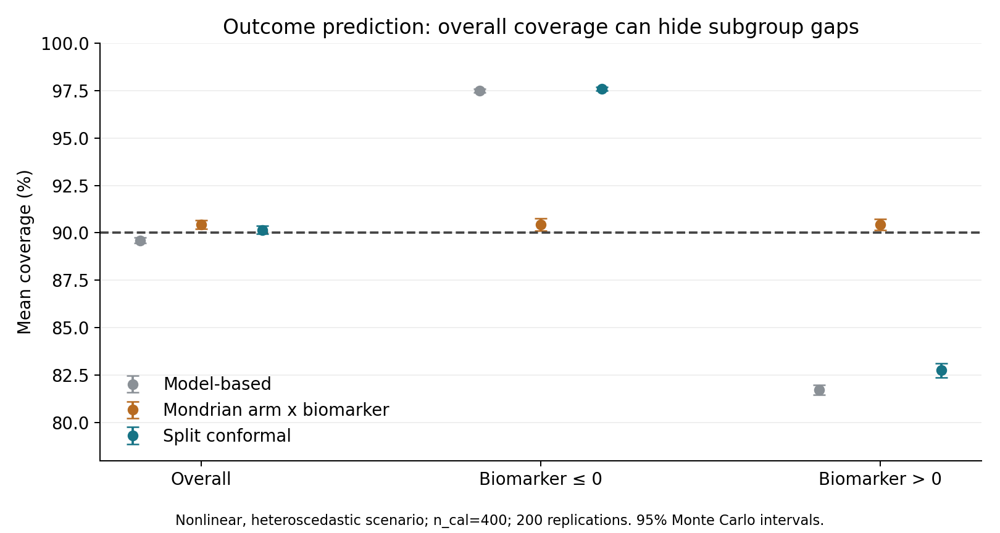
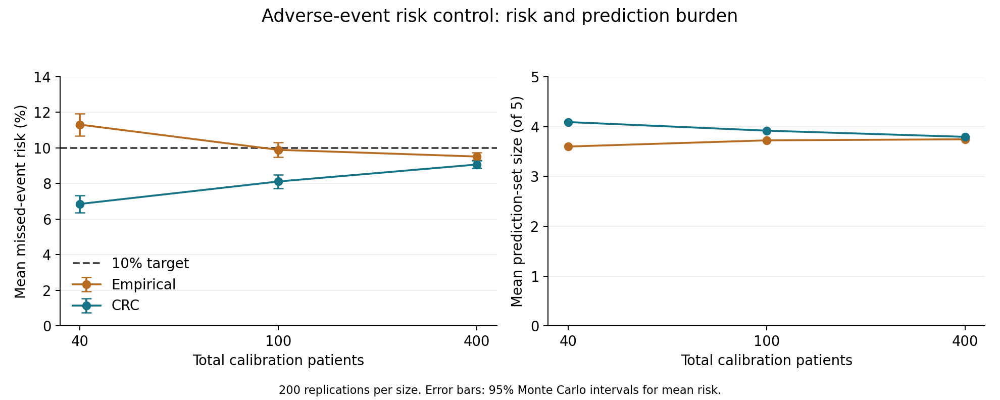

# Simulation results

This report brings together the trial analysis, outcome prediction and adverse-event
prediction experiments. Results are simulation evidence, not findings about a drug.
The predictive modules use independent cohorts of 1,000 training and 2,000 test
patients, with separate calibration cohorts. They do not train on the 240-person
trial alone. All predictive results below average 200 replications.

## 1. Standard trial analysis

A balanced randomized trial of 240 patients compares mean week-12 improvement,
adjusting for baseline score, age and biomarker. The efficacy test uses alpha=0.05.
Across 1,000 replications per scenario, the author reported:

| Scenario | Rejection rate | Monte Carlo SE | 95% Monte Carlo interval | Bias | RMSE | 95% CI coverage |
|---|---:|---:|---:|---:|---:|---:|
| Null, effect=0 | 3.8% | 0.60 percentage points | 2.70%–5.18% | 0.0096 | 0.9831 | 96.2% |
| Alternative, effect=3 | 79.6% | 1.27 percentage points | 76.97%–82.06% | -0.0112 | 1.0738 | 94.3% |

The null rejection rate is compatible with 5% given Monte Carlo uncertainty.
The alternative has approximately 80% power under these specific assumptions.
These numbers were transcribed from the author's console output; the underlying
baseline CSV was not supplied. Reproduce them with the operating-characteristics
script before replacing this narrative with a newly generated table.

## 2. Individual-outcome prediction

The linear model is compared with arm-specific split conformal intervals and
four-cell Mondrian intervals using treatment arm × biomarker sign. The latter
partition is fixed before calibration. The subgroup threshold is a simulation
choice, not a clinically validated cutoff. Nominal prediction coverage is 90%.

In the nonlinear, heteroscedastic scenario with n_cal=400:

| Method | Overall coverage | Biomarker ≤ 0 | Biomarker > 0 | Overall mean width |
|---|---:|---:|---:|---:|
| Model-based | 89.60% | 97.48% | 81.73% | 34.92 |
| Arm-specific split conformal | 90.16% | 97.59% | 82.75% | 35.89 |
| Four-cell Mondrian | 90.44% | 90.44% | 90.43% | 32.95 |

Arm-specific coverage can coexist with substantial biomarker subgroup undercoverage.
Mondrian calibration reallocates interval width to the high-variance subgroup.
Its approximately 8.2% smaller average width here is scenario-specific. Under the
linear scenario, Mondrian width was 27.03 versus 26.56 for arm-specific CP.

Small groups create a practical cost. With n_cal=40, 78% of Mondrian replications
had at least one infinite-width interval, in both scenarios. With n_cal=100 in the
nonlinear scenario, mean coverage was 92.00% and width 37.48. At n_cal=400,
coverage was 90.44% and width 32.95. Infinite intervals are the explicit safe
fallback when the required conformal rank exceeds the available group count.

Sources: [Mondrian summary](../results/reference/mondrian_summary.csv),
[calibration records](../results/reference/mondrian_calibration.csv), and
[original CP summary](../results/reference/cp_summary.csv). Full Monte Carlo
uncertainty is retained in the CSVs.

## 3. Adverse-event conformal risk control

Five logistic models produce probabilities for five adverse-event labels. For a
patient with observed label set Y and prediction set C, loss is
`|Y minus C| / max(1, |Y|)`. Patients with no events contribute zero. The target is
expected patient-wise missed-event fraction at most 10%.

Empirical and CRC thresholds use the same calibration patients and are fitted
separately by arm. CRC adds the finite-sample correction described in the
[CRC guide](../docs/crc-guide.md).

| Total calibration size | Empirical mean risk | CRC mean risk | CRC 95% MC interval | Empirical mean set size | CRC mean set size |
|---|---:|---:|---:|---:|---:|
| 40 | 11.31% | 6.85% | 6.37%–7.33% | 3.60 | 4.09 |
| 100 | 9.89% | 8.11% | 7.74%–8.49% | 3.72 | 3.92 |
| 400 | 9.52% | 9.07% | 8.86%–9.27% | 3.74 | 3.79 |

At n_cal=40, empirical tuning exceeded the target on average, while CRC was more
conservative. At n_cal=400 both means were below the target and their set sizes
were similar. The empirical comparator has no corresponding CRC expectation
guarantee. The fixed 0.50 threshold produced approximately 61% risk and almost
empty sets, making empirical tuning the more informative comparator here.

At n_cal=400, CRC risk was 9.23% in control and 8.90% in the investigational arm.
It was 11.80% for biomarker ≤ 0 and 6.32% for biomarker > 0. Arm-specific
calibration does not guarantee these biomarker subgroup risks.

Approximately 39% of patients had no events. Among event-positive patients, CRC
missed-event fraction averaged 14.85%. That conditional quantity is not the
calibrated loss target. The average set contained 3.79 of five labels, and 13.19%
of patients received all five. This is substantial prediction burden, not evidence
of a highly discriminating or clinically useful safety predictor.

Overall test risk exceeded 10% in 27% of n_cal=400 replications. The CRC guarantee
is an expectation over calibration and future observations, not a high-probability
bound for each fitted threshold. Finite test-set noise also contributes to this
diagnostic. Calibration within each arm respects the balanced-randomization design.

Sources: [CRC summary](../results/reference/crc_summary.csv) and
[calibration records](../results/reference/crc_calibration.csv).

## 4. Reproducibility and verification

The committed reference files are unchanged author-supplied outputs from local R
execution. Checksums and original names are in the reference provenance file.
Checks confirmed calibration sample counts, conformal ranks, threshold mappings,
CRC corrections, threshold nesting and reported Monte Carlo interval arithmetic.
The uploaded CRC summaries and calibration records do not allow independent
reconstruction of all test performance averages; test replicate metrics and
patient-level predictions would be needed for that audit.

The author reported a baseline test pass. Later test logs were not supplied.
The packaging environment lacks R, so code structure checks are not presented as
R runtime validation. Use the included tests and inspect the first GitHub Actions
run. The CI workflow executes short simulations for integration checks; those runs
are not the source of the 200-replication reference results.

## 5. Scope of the portfolio

The project demonstrates analysis planning, randomized-trial simulation, adjusted
effect estimation, operating characteristics, independent prediction calibration,
subgroup diagnostics and reproducible programming. It does not establish clinical
trial work experience, efficacy or safety of a real treatment, or readiness for
regulatory use. Phase I dose finding, Phase III multiplicity, missing outcomes,
severity-weighted losses and real-data validation remain outside this release.
